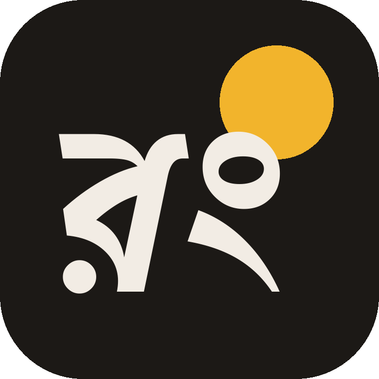
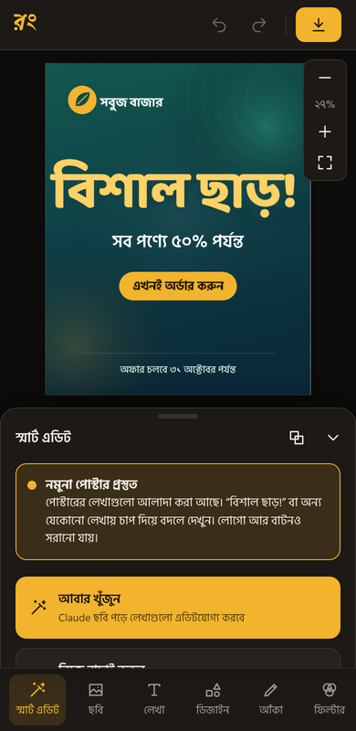
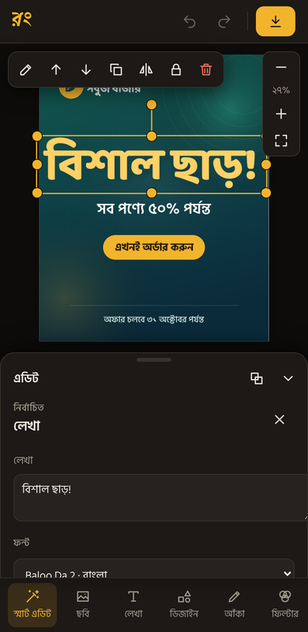
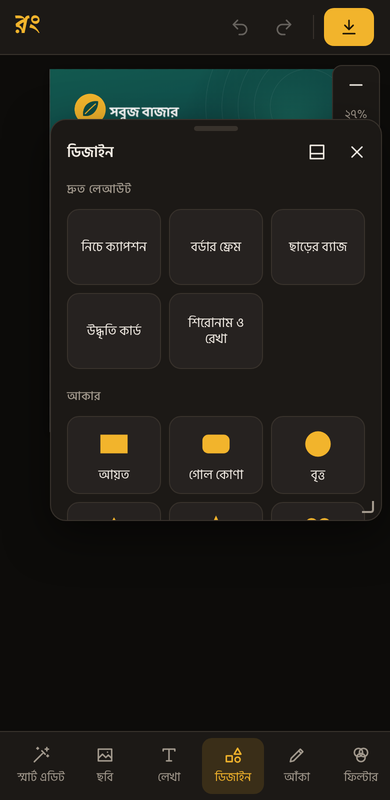

<p align="center"></p>

<h1 align="center">রং স্টুডিও</h1>

<p align="center">ছবির ভেতরের লেখায় চাপ দিন, আর সরাসরি বদলে ফেলুন।<br>বাংলা ও ইংরেজি লেখা পড়তে পারে, ইন্টারনেট ছাড়াই চলে।</p>

<p align="center"><a href="https://github.com/hemelsid/Rong-Studio/raw/main/releases/RongStudio-v1.7.apk"><b>⬇ সর্বশেষ অ্যাপ ডাউনলোড করুন (v1.7)</b></a></p>

<p align="center">
  
  
  
</p>

---

## যা করা যায়

- **ছবির লেখা এডিট:** ছবি দিলে অ্যাপ প্রতিটা শব্দ খুঁজে দাগ দেয়। যে শব্দে চাপ দেবেন শুধু সেটা মুছে একই জায়গায় এডিটযোগ্য লেখা বসে। অ্যাপ সব ফন্টের সাথে আকার মিলিয়ে সবচেয়ে কাছের ফন্ট নিজেই বেছে নেয়। লেখার মাপ, অক্ষরের ফাঁক, গ্রেডিয়েন্ট, আউটলাইন, ছায়া, আভা আর নরম কিনারাও মিলিয়ে বসায়। তারপর শব্দ, ফন্ট, রঙ, আকার, আউটলাইন বদলানো যায়।
- **লোগো ও ডিজাইন আলাদা করা:** “নিজে বাছাই করুন” দিয়ে কোনো অংশ ঘিরে দিলে সেটা আলাদা স্তর হয়ে যায়। তখন সরানো, বড়-ছোট করা আর রঙ বদলানো যায়। কোনো অংশ মুছেও ফেলা যায়।
- **নতুন লেখা ও ডিজাইন:** তৈরি স্টাইলের লেখা, আকার, ইমোজি আর দ্রুত লেআউট আছে, যেমন ক্যাপশন পটি, ফ্রেম, ছাড়ের ব্যাজ, উদ্ধৃতি কার্ড।
- **১৭টি ফন্ট:** এর মধ্যে ৮টি বাংলা (Hind Siliguri, Anek Bangla, Baloo Da 2, Tiro Bangla, Galada…)। নিজের .ttf বা .otf ফন্টও যোগ করা যায়।
- **ফিল্টার:** ৮টি প্রিসেট আছে। উজ্জ্বলতা, কনট্রাস্ট, উষ্ণতা, ঝাপসা ইত্যাদি নিজে ঠিক করা যায়।
- **আঁকা, ক্রপ, ঘোরানো, মাপ বদল:** ইনস্টাগ্রাম, স্টোরি, ফেসবুক কভার, ইউটিউব থাম্বনেইলের মাপ তৈরি আছে।
- **লেয়ার, আনডু-রিডু।**
- **পুরো স্ক্রিন ক্যানভাস:** দুই আঙুলে জুম করা আর সরানো যায়। ফাঁকা জায়গায় দুইবার চাপলে ছবি স্ক্রিনে মানিয়ে যায়।
- **সরানো যায় এমন প্যানেল:** টেনে বড়-ছোট বা বন্ধ করা যায়। ভাসমান করে স্ক্রিনের যেকোনো পাশে রাখা যায়।
- **সেভ:** PNG, JPG বা WebP ফরম্যাটে গ্যালারির `Pictures/Rong Studio` ফোল্ডারে সেভ হয়।

## ইনস্টল

1. নিচের **ভার্সনসমূহ** তালিকা থেকে APK ডাউনলোড করুন। সবচেয়ে উপরেরটাই সর্বশেষ।
2. ফাইল ম্যানেজার থেকে ফাইলটা খুলুন। “অজানা অ্যাপ ইনস্টল” এর অনুমতি চাইলে চালু করুন।
3. Play Protect সতর্ক করলে **More details → Install anyway** চাপুন।

নতুন ভার্সন আগের অ্যাপের উপরেই ইনস্টল হয়, কিছু মুছতে হয় না। Android 7 বা তার নতুন ফোনে চলে।

গ্যালারি থেকে কোনো ছবি **শেয়ার → রং স্টুডিও** করলে সেটা সরাসরি এডিটরে খোলে।

## ভার্সনসমূহ

প্রতিটা ভার্সনের APK [`releases/`](releases) ফোল্ডারে রাখা আছে, আর GitHub-এর [Releases পাতাতেও](https://github.com/hemelsid/Rong-Studio/releases) আলাদা করে পাওয়া যায়। যেকোনো সময় ডাউনলোড করা যায়, লিংকে চাপলেই ফাইল নেমে আসবে।

| ভার্সন | ডাউনলোড | যা বদলেছে |
|---|---|---|
| **v1.7** (সর্বশেষ) | [APK, ৯ MB](https://github.com/hemelsid/Rong-Studio/raw/main/releases/RongStudio-v1.7.apk) | আসল লেখার মাপ, অক্ষরের ফাঁক, গ্রেডিয়েন্ট, আউটলাইন, ছায়া, আভা আর নরম কিনারা নিজে থেকে মেলায়। গ্রেডিয়েন্ট, ছায়া ও আভা, নরম কিনারা আর রঙ তোলার ড্রপার কন্ট্রোল। |
| v1.6 | [APK, ৯ MB](https://github.com/hemelsid/Rong-Studio/raw/main/releases/RongStudio-v1.6.apk) | শব্দে চাপ দিলে শুধু সেই শব্দ এডিট হয়, ফন্ট নিজে থেকে মিলিয়ে বসে, সেরা মিলের ফন্ট বোতাম হিসেবে দেখায়। ভুল পড়া লেখা নিজে টাইপ করে বদলানো যায়। |
| v1.5 | [APK, ৯ MB](https://github.com/hemelsid/Rong-Studio/raw/main/releases/RongStudio-v1.5.apk) | নিজের ফন্ট (.ttf / .otf) যোগ করা যায়, অ্যাপ মনে রাখে। ফন্ট বদলালে লেখা দুই লাইনে ভাঙে না। |
| v1.4 | [APK, ৯ MB](https://github.com/hemelsid/Rong-Studio/raw/main/releases/RongStudio-v1.4.apk) | উপরের বারে “নতুন ছবি” বোতাম: আগের কাজ সরিয়ে নতুন ছবি খোলে, আনডু দিয়ে ফেরা যায়। |
| v1.3 | [APK, ৯ MB](https://github.com/hemelsid/Rong-Studio/raw/main/releases/RongStudio-v1.3.apk) | খুঁজে পাওয়া লেখা আসল মাপের কাছাকাছি বসে। পাশের তারা বা আইকনের জন্য লেখা আর বড় হয়ে যায় না। প্যানেল খুললে উপর থেকে শুরু হয়। |
| v1.2 | [APK, ৯ MB](https://github.com/hemelsid/Rong-Studio/raw/main/releases/RongStudio-v1.2.apk) | পুরো স্ক্রিন ক্যানভাস, দুই আঙুলে জুম, প্রথম চাপে লেখা নড়ে না, টেনে সরানো ও ভাসমান প্যানেল। |
| v1.1 | [APK, ৯ MB](https://github.com/hemelsid/Rong-Studio/raw/main/releases/RongStudio-v1.1.apk) | Android 7 থেকে চলে। যেসব ফোনে “App not installed” আসত সেখানে ইনস্টল হয়। |

## ফোল্ডার

```
web/rong-studio.html   পুরো এডিটর, একটি ফাইলে (claude.ai আর্টিফ্যাক্ট হিসেবেও চলে)
android/               অ্যান্ড্রয়েড অ্যাপ: WebView-এর ভেতরে এডিটর চালায়
  smali/               অ্যাপের কোড: গ্যালারি থেকে ছবি নেওয়া, গ্যালারিতে সেভ, শেয়ার থেকে খোলা
  assets/              ফন্ট, fabric.js, লেখা পড়ার টুল (tesseract.js) ও বাংলা-ইংরেজি ভাষার ফাইল
tools/build.sh         সাইন করা APK বানায়
tools/make_index.py    ওয়েব এডিটর থেকে অ্যাপের অফলাইন পেজ বানায়
tools/zipalign.py      APK সাজায় (Android SDK ছাড়াই)
releases/              প্রতিটা ভার্সনের APK আর তার পরিবর্তনের নোট
```

## নিজে APK বানানো

দরকার: Java 17+, Python 3 আর npm।

```bash
export RONG_KEY_PASS='আপনার-পাসওয়ার্ড'      # সাইনিং চাবির পাসওয়ার্ড
export RONG_KEYSTORE=~/.rong/rong.keystore    # সাইনিং চাবির ফাইল
./tools/build.sh 1.4 5                        # ভার্সনের নাম, ভার্সন কোড
```

তৈরি ফাইল `build/RongStudio-v1.4.apk` এ পাওয়া যাবে। প্রতিবার ভার্সন কোড অন্তত ১ বাড়াতে হবে।

নতুন ভার্সন প্রকাশ করতে APK-টা `releases/` ফোল্ডারে রাখুন, সঙ্গে একই নামের একটা `.md` ফাইলে কী বদলেছে লিখুন। তারপর README-র ভার্সন তালিকায় একটা লাইন যোগ করুন। `.github/workflows/releases.yml` চালু থাকলে GitHub নিজে থেকেই প্রতিটা ভার্সনের জন্য Release পাতা বানিয়ে দেবে।

> **সাইনিং চাবি (`rong.keystore`) এই repo-তে নেই, রাখবেনও না।** repo-টা public। সব আপডেট একই চাবি দিয়ে সাইন করতে হয়, না হলে ফোন পুরোনো অ্যাপের উপরে নতুনটা ইনস্টল করতে দেবে না। চাবিটা নিরাপদ জায়গায় (Google Drive, পেনড্রাইভ) রেখে দিন।

## যা দিয়ে বানানো

[Fabric.js](http://fabricjs.com/) (ক্যানভাস এডিটিং), [Tesseract.js](https://tesseract.projectnaptha.com/) (অফলাইনে লেখা পড়া), [Fontsource](https://fontsource.org/) থেকে Google Fonts, আর [apktool](https://apktool.org/) (APK বানানো)। ফন্টগুলো SIL Open Font License-এর অধীনে। বাকি টুলগুলো Apache 2.0 বা MIT লাইসেন্সের।
